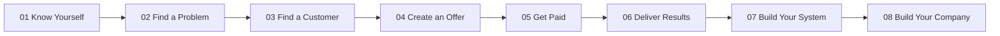

# 🐍 Solopreneur 90 Days

### Turn yourself into a company(brand).

> An open-source operating system for founders, developers, employees, freelancers, and students who want to build independent economic capability while working inside the real market.

[](LICENSE)
[](journey/90-day-roadmap.md)
[](frameworks/founder-os.md)

## 🧭 The project

**Solopreneur 90 Days is an open-source market-first apprenticeship.** It turns knowledge into evidence: a market, a customer problem, an offer, a sale, a delivery system, and eventually a company.

This repository is the **free/open layer**. A separate paid program can sit on top of it with coaching, accountability, implementation support, private playbooks, reviews, and a client-acquisition guarantee. See [Open Source vs Paid](premium/OPEN-SOURCE-VS-PAID.md).

### Start here

1. [START-HERE.md](START-HERE.md) — choose your entry point.
2. [90-Day Roadmap](journey/90-day-roadmap.md) — execute the system.
3. [Market Realities](MARKET-REALITIES.md) — remove fantasy from the plan.
4. [Occupation → Market Gap Audit](templates/occupation-market-gap-audit.md) — find your leverage.
5. [Vertical Selection](frameworks/vertical-selection.md) — choose a narrow market.
6. [Business Model Matrix](business-models/README.md) — choose how you get paid.
7. [Acquisition](acquisition/README.md) — turn conversations into pipeline.
8. [Technology Stack](technology/stack.md) — use technology as leverage, not decoration.
9. [AI / Bring Your Own Agent](ai/README.md) — use AI to compress research, building, and execution.
10. [Knowledge Graph](graph/README.md) — connect your learning and evidence.

## The 8-stage operating system



The sequence is deliberately simple:

**Capability → Problem → Customer → Offer → Sale → Result → System → Company.**

## The 90-day progression

| Stage | Days | Primary proof |
|---|---:|---|
| 0 — Baseline | 1–3 | Founder profile |
| 1 — Market | 4–10 | Real customer problem |
| 2 — Model | 11–17 | Business model decision |
| 3 — Offer | 18–24 | Sellable offer |
| 4 — Build | 25–35 | Working prototype / delivery system |
| 5 — Acquire | 36–49 | Qualified pipeline |
| 6 — Sell | 50–60 | First paying customer |
| 7 — Productize | 61–70 | Repeatable delivery |
| 8 — Scale | 71–80 | Measured acquisition + economics |
| 9 — Founder Mode | 81–90 | Long-term company plan |

The objective is not to finish 90 lessons. The objective is to finish with **economic evidence**.

## What you should have by Day 90

```text
Founder profile
+ Market map
+ Customer interviews
+ Offer
+ Prototype / delivery system
+ Outreach system
+ CRM / pipeline
+ Sales conversations
+ Customer result
+ SOPs
+ Case study
+ Revenue model
+ Next 12-month plan
```

## The core model

### 1. Occupation → Capability

Your current occupation is an **asset inventory**, not an identity prison.

Ask what you already understand, what customers pay your employer for, what work you repeatedly perform, which systems you use, and what information you know that outsiders do not.

### 2. Capability → Gap

Identify the smallest missing capability required to create customer value:

```text
Technical gap | Sales gap | Distribution gap | Domain gap
Product gap | Automation gap | Leadership gap | Capital gap
Communication gap
```

The goal is not to learn everything. It is to learn **what unlocks the next customer outcome**.

### 3. Gap → Offer

```text
Skill ≠ Offer
Technology ≠ Offer
Idea ≠ Offer

Offer = Customer problem + measurable outcome + delivery mechanism + price
```

### 4. Offer → Customer

Evidence begins with:

**conversation → proposal → sale → delivery → result**

### 5. Customer → Company

```text
Repeated problem
      ↓
Reusable workflow
      ↓
Template
      ↓
Automation
      ↓
Productized service
      ↓
Software / AI product
```

This is the company-building path.

## 🧠 Founder Operating Loop

Every day:

**Learn → Research → Build → Talk → Sell → Measure → Document → Improve**

Every week:

**One market insight + one shipped asset + customer conversations + one measured improvement.**

Every 30 days:

**Re-evaluate market, offer, economics, skills, and leverage.**

## 💰 Revenue discipline

This repository does **not** promise $1M in 90 days.

It teaches the mechanics behind progressively larger outcomes:

```text
$0 → First sale → $1K → $10K → $100K → $1M annual revenue
```

The question is always:

> **What must be true for the next revenue milestone to happen?**

See [Revenue Math](frameworks/revenue-math.md).

## 🏭 Vertical-first thinking

Start narrow. Examples to investigate:

- Education
- Healthcare
- Real estate
- Manufacturing
- Construction
- Logistics
- Finance
- Legal
- Retail
- Hospitality
- Local businesses
- Professional services
- Creator businesses
- AI-native businesses

See [Verticals](verticals/README.md).

## 🧰 Technology as leverage

Use technology according to the business problem:

- Linux
- Git / GitHub
- Python
- FastAPI
- React / TypeScript
- PostgreSQL / pgvector
- APIs
- AI / LLMs
- Voice AI
- Agents
- Automation
- Local-first systems
- Cloud infrastructure
- Analytics

See [Technology Stack](technology/stack.md).

## 🔬 Case-study laboratory

The curriculum is grounded in real build patterns rather than abstract startup theory. Relevant public projects include:

- [MW.AI](https://github.com/Manidhar8008) — vertical AI / business systems laboratory
- [Vasuki Workspace](https://github.com/Manidhar8008/Vasuki_workspace) — personal intelligence / operating-system concepts
- [Vasuki Memory Engine](https://github.com/Manidhar8008/vasuki-memory-engine) — memory and retrieval engineering
- [Janani.ai](https://github.com/Manidhar8008/JANANI.AI) — personal intelligence / discipline-oriented product concepts
- [Solopreneur 90 Days](https://github.com/Manidhar8008/Solopreneur-90-days) — this open curriculum

These projects are laboratories and evidence sources, not promises of outcomes for learners.

## 🌍 Open-source mission

The open-source layer should become a reusable operating system for people across occupations, countries, and industries.

Contributions should add evidence or execution leverage:

- New occupation pathways
- New verticals
- Acquisition playbooks
- Tool comparisons
- Case studies
- Translation
- Exercises
- Market evidence
- Local business examples
- Technical labs

The standard:

> **Add something that moves another person closer to a real capability, real customer, real result, or real business.**

## 💎 The paid layer

The open repository is intentionally useful on its own. The paid program is a different product: **implementation, accountability, personalization, review, and speed.**

### Paid program concept

**90-Day Client Engine**

- Positioning: build and sell a high-value service/product around an existing capability.
- Target outcome: secure a first client worth **₹1,00,000 within 90 days**.
- Stated value stack: **₹25,00,000+** of frameworks, implementation assets, reviews, systems, and support.
- Guarantee model: money-back guarantee tied to clearly published participation and execution criteria; it should be written as an auditable policy, not an unconditional claim.

The paid-program architecture is documented separately so the public curriculum remains open-source:

- [Open Source vs Paid](premium/OPEN-SOURCE-VS-PAID.md)
- [Premium Program Architecture](premium/README.md)

A future website can live inside this repository without mixing private course material into the open curriculum.

## What this repository is NOT

- Not a motivational course.
- Not a generic startup-quote collection.
- Not a “quit your job” challenge.
- Not a promise of $1M in 90 days.
- Not a substitute for market evidence or customer work.

## License

Open source. See [LICENSE](LICENSE).
